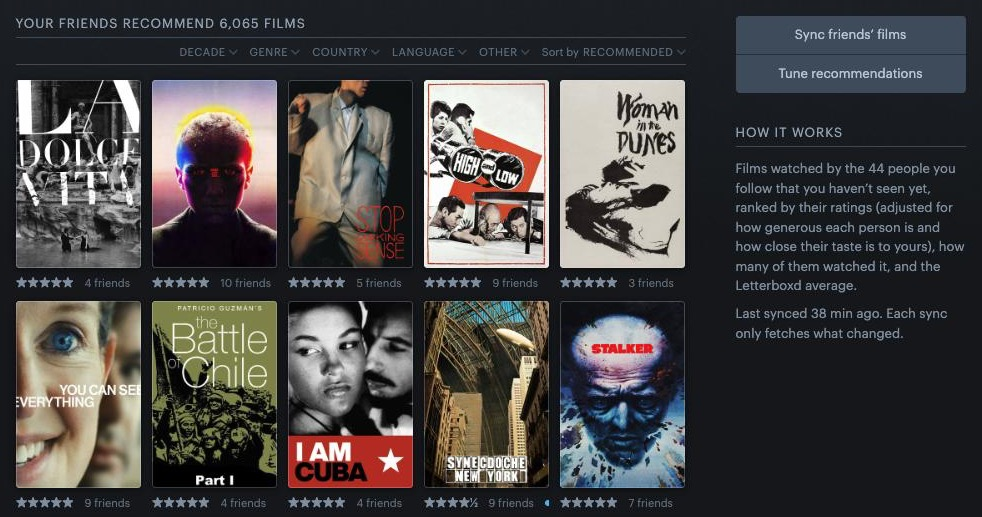
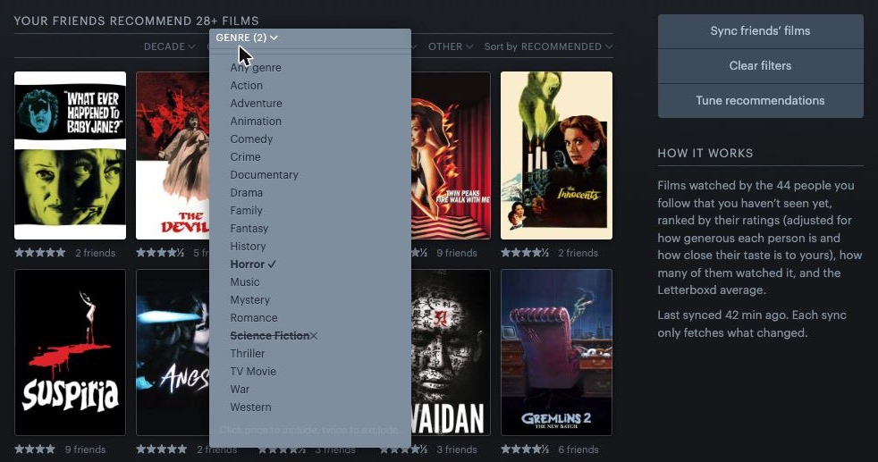

# Letterboxd Friend Recs

A userscript that adds a **Recs** tab to your Letterboxd profile: films you haven't seen, recommended by the people you follow.




## Features

- Native-looking page in your profile, next to Watchlist, plus a "Friend recs" item in the account menu
- Ranked from your friends' ratings, weighted by how close their taste is to yours, how many watched it, and the Letterboxd average
- Sort by **Recommended**, **Most watched by friends** or **Friends' rating**
- Filters by decade, genre (include / exclude), country, language, films / series, shorts, watchlist
- Hover a poster to see who watched it and what they rated it



## Install

1. Install [Tampermonkey](https://www.tampermonkey.net/) or [Violentmonkey](https://violentmonkey.github.io/) (Chrome, Firefox, Zen, Edge…). In Chrome, also turn on **Allow User Scripts** in the extension's details.
2. **[Install the script](https://raw.githubusercontent.com/YofarDev/letterboxd-friend-recs/main/letterboxd-friend-recs.user.js)**. Updates are automatic.
3. Open your Letterboxd profile → **Recs** → **Sync now**.

The first sync reads your friends' films once (a few minutes). After that it only fetches what changed, automatically every 12 hours.

## How it works

- Reads the same pages you'd browse (your follows, their films and ratings) and caches them in your browser (IndexedDB).
- Each friend's ratings are normalized (harsh vs. generous raters), weighted by how well they correlate with yours, and blended with the global rating:
  `score = (Σ w·r' + k·G) / (Σ w + k) + β·ln(1 + friends who watched)`
- Weights are adjustable under **Tune recommendations**.

## Privacy & fair use

- Everything stays in your browser. The script only talks to letterboxd.com.
- Unofficial, not affiliated with Letterboxd. Requests are deliberately slow (1–2 at a time, with pauses) and incremental. Please keep it that way.

## Development

```bash
npm install
npm test    # end-to-end test in jsdom against a fake Letterboxd
```

## License

[MIT](LICENSE)
